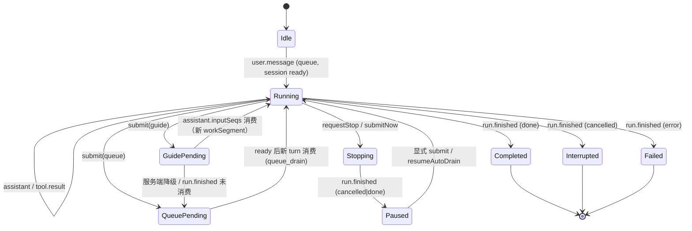

# @keel/chat-surface

Keel 的 **headless 会话投影核心**：keel 事件（SSE 快照/增量 + 本地乐观输入）→
`ConversationView`。零 DOM、零 React、零 NSH、零运行时依赖；`EventSource` 与
`SurfaceCommands` 由宿主注入（不直接 `fetch`）。

- 契约：`src/types.ts`（冻结）
- 事件/映射/对齐表：仓库根 `docs/CHAT-SURFACE.md`
- 规格：`openspec/changes/keel-agent/specs/chat-surface/spec.md`

## 用法

```ts
import { ChatSurfaceEngine, toAgUi } from "@keel/chat-surface";
import type { EventSource, SurfaceCommands } from "@keel/chat-surface";

const engine = new ChatSurfaceEngine({ sessionId, windowTurns: 200 });

// 1) 事件：幂等 apply；批量/补洞用 applyMany；冷启动用 hydrate
engine.apply({ seq: 1, kind: "user.message", payload: { text: "hi", requestId: "r1" } });

// 2) 乐观输入：发送后立即上屏，权威事件按 requestId 收敛
engine.submit("hello", "queue", "r2");     // queue 默认
engine.submit("steer", "guide", "r3");     // 运行中：等待引导

// 3) 投影
const view = engine.view();
// view.turns[].workSegments[].toolCalls / assistantOutput / postTurnEvents / runSummary
// view.queue  -> delivery=queue 进队列面板；delivery=guide 渲染在对话流末尾
// view.decisions -> 审批卡
// view.busy / view.stopping / view.connection -> 停止按钮 / 连接状态

// 「立即发送」：stop barrier + reservation（宿主用同一 requestId 发送）
engine.submitNow("urgent", requestId);
engine.requestStop();

// 4) 订阅
const off = engine.subscribe(() => render(engine.view()));

// 5) 续传：先快照分页，再订阅；断线回到 open 时先补拉
const detach = await engine.attach(source, { partials: true });

// 6) 停止（barrier）
engine.requestStop();
await commands.stop();       // 宿主命令面；run.finished 确认后 stopping 自动清除

// 7) AG-UI（可选渲染器接口）
const agui = toAgUi(events, { view });
```

## 状态机



queue/guide/stop 的详细判定（含 zcode 对齐表与刻意差异）见 `docs/CHAT-SURFACE.md` §5。

## 约定

- **transport 边界**：核心不持有连接；`EventSource.list/stream` 由宿主实现。
- **权威队列**：核心不维护第二份队列，`view.queue` 是事件 + 本地乐观输入的投影。
- **确定性**：无定时器、无随机；同一事件 fixture 逐字节一致（乐观 `createdAt` 可注入 `now`）。
- **有界**：默认最近 200 个 turn（`windowTurns: 0` 关闭）；工具索引随 turn 裁剪。
- **partial**：`applyPartial` 不进入 `ConversationView`，读 `engine.partial()`；提交消息到达即清空。

## 开发

```bash
bun test                  # 投影/状态机/续传/审批/AG-UI/10k 性能
bun test test/perf.test.ts
tsc --noEmit              # 仅 src（tests 由 Bun 运行）
```
